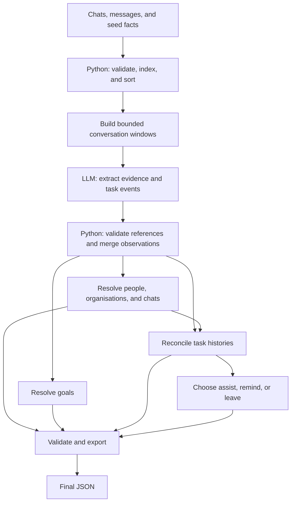

**Session 02 conversation transcript**

Editorial coverage note (not an original conversation message): The message bodies below are copied from the conversation history accessible to Codex, preserving their wording, order, and Markdown. Numbered speaker labels and this coverage note identify boundaries; they are not part of the original messages. Four-backtick fences preserve the original formatting as text, including the diagram in the complete final response.

Coverage begins with the user's Phase 2 architecture-design request and ends with Codex's opening acknowledgement of the Session 02 transcript request. It includes both user prompts in that interval, five Codex progress messages, the exact model-budget question presented through the user-input tool, and the complete architecture-design final response. No natural-language user prompt or Codex response within that visible interval has been shortened or replaced with a summary. No answer to the model-budget question is visible within this interval.

Tool calls and tool outputs are visible in the accessible conversation history. They are intentionally not reproduced here: this file records the user-facing conversation, not a raw execution audit. At least one Session 02 tool result explicitly reports truncated output; the omitted portion of that result is not available in the visible history and has not been reconstructed. The user-facing question delivered through a tool is included verbatim and labelled accordingly. Private reasoning and system/developer instructions are not included. Other sessions, deleted or otherwise unexposed messages, and content outside the stated interval are not claimed as recovered. Messages after the cutoff, including the final confirmation of this file's creation, are outside this transcript's coverage.

The architecture report and both Session 01 files are separate artifacts and are preserved unchanged. This transcript copies the actual conversation messages rather than substituting text from the architecture report.

**01 — User — Phase 2 architecture-design request**

````text
We have completed the repository inspection for the XPERT Lab Cold Start Internship Challenge.

Now I want to move to Phase 2: SOLUTION ARCHITECTURE DESIGN.

Act as a senior AI/ML engineer and explain the architecture to me as a beginner. Our objective is to build a reliable, accurate, cost-efficient system that generalises to the hidden evaluation dataset.

IMPORTANT: This phase is for architecture and planning only. Do not implement anything yet.

## 1. Overall Architecture

Design an end-to-end architecture that converts WhatsApp chat history into the five required output categories:

- People
- Organisations
- Chats
- Goals
- Open loops

Explain every component and its responsibility.

## 2. Data Processing Pipeline

Explain how we should:

- Load and preprocess chats, messages, and seed information.
- Group messages by chat and chronological order.
- Preserve message IDs and evidence.
- Handle missing replies and media placeholders.
- Handle English, Hindi, Bengali, and Hinglish.
- Build useful conversation context without repeatedly sending the entire dataset to an LLM.

## 3. Intelligence and Reasoning Layer

Design separate approaches for:

- People and relationship classification.
- Organisation discovery and grouping.
- Chat-to-person or organisation assignment.
- Goal extraction.
- Open-loop detection.
- Ownership identification.
- Tracking task updates, completion, and cancellation.
- Choosing between assist, remind, and leave.

For each component, explain which tasks should use deterministic Python logic and which should use an LLM.

## 4. LLM Strategy

Evaluate the best approach for:

- Model selection through the OpenAI-compatible endpoint.
- Prompt design.
- Batching and context management.
- Structured JSON output.
- Validation and retries.
- Caching and avoiding duplicate calls.
- Token usage, latency, and cost optimisation.

Do not assume that one LLM call per message is appropriate.

## 5. Evaluation Strategy

Explain how we should evaluate each component independently using the development data.

Respect the fact that goals and help decisions are not labelled in the development dataset.

Explain how to avoid using answer keys during inference and how to identify false positives and false negatives.

## 6. Proposed Project Architecture

Provide:

- A proposed Python module/folder structure.
- A detailed end-to-end data flow.
- Responsibilities of each module.
- The order in which we should implement the modules.
- Major risks and how to mitigate them.

## 7. Important Design Decisions

Compare at least two possible approaches wherever meaningful. Explain trade-offs and recommend one with reasons.

Prioritise accuracy, generalisation, reproducibility, runtime, and cost.

## DOCUMENTATION

Create:

`ai-logs/codex/session-02-architecture-design.md`

Include the complete architecture proposal, alternatives considered, reasoning behind recommendations, unresolved questions, and implementation sequence.

Preserve the existing Session 01 report and transcript unchanged.

## STRICT RULES

- Do not modify solution.py, llm.py, schema.json, check.py, or run.sh.
- Do not implement code.
- Do not run the solution.
- Do not access development answer keys.
- Do not invent challenge requirements.
- Clearly distinguish verified requirements from proposed design decisions.
- Explain technical concepts in beginner-friendly language.

At the end, present your recommended architecture and wait for my approval before implementation.
````

**02 — Codex — Progress message**

````text
I’ll design the pipeline, reasoning stages, model strategy, and evaluation plan, then save the full proposal in the Session 02 document. I’ll preserve the existing files and distinguish verified challenge requirements from design recommendations.
````

**03 — Codex — Progress message**

````text
I recommend a staged pipeline: read each conversation in manageable batches, preserve evidence in compact records, then reconcile people, organisations, and tasks across batches. This avoids sending the whole history repeatedly while retaining the messages needed to check decisions.

Two constraints shape the design: the final schema has no “unknown” circle, so uncertainty must be tracked internally; and an LLM’s claim that a task is done needs supporting message evidence before we close it.
````

**04 — Codex — Model-budget question presented through the user-input tool**

````text
For the later model benchmark, do you already have an OpenAI-compatible provider/model and a testing budget? Please share the provider/model names and a spending limit if decided; do not share API keys. I’ll keep the architecture provider-neutral if these are undecided.
````

**05 — Codex — Progress message**

````text
The proposal now separates initial extraction from final decisions. One reading pass collects evidence for all five categories; later stages resolve relationships and task histories, so a short “done” message can be matched to an earlier promise without rereading everything.

I’ve also included separate handling for incomplete dev labels: an unmatched prediction is an official scoring miss, but it needs manual review before we call it a genuine false positive.
````

**06 — Codex — Progress message**

````text
The full proposal is saved. It includes the module structure, staged implementation plan, model-selection criteria, retry and cache policies, evaluation methods, and alternatives considered.

The main recommendation is one configured model with targeted review calls, backed by Python validation and a task history that retains closure evidence. Chunk sizes, concurrency, and budget limits are marked as proposed starting points to benchmark, not verified settings.
````

**07 — Codex — Complete final response to the architecture-design request**

````text
Created the complete proposal in [session-02-architecture-design.md](</C:/Users/Shalu Chauhan/OneDrive/Documents/Xpert/xpert-cold-start-starter/cold-start/ai-logs/codex/session-02-architecture-design.md>).

**My recommendation is a staged pipeline that preserves evidence: Python manages data and consistency; an LLM interprets conversation meaning.** Every important conclusion should remain connected to its original messages.

Think of it as maintaining two notebooks: a **relationship directory** describing people and organisations, and a **task ledger** recording promises, updates, completion, and cancellation.



**The first reading pass should produce reusable evidence, followed by separate decisions.**

Instead of asking the model to produce the entire final answer repeatedly, each conversation window produces observations: relationship clues, organisation clues, possible goals, new obligations, and task updates.

Later stages combine these observations across chats. They retrieve original messages when evidence is ambiguous.

| Component | Python’s responsibility | LLM’s responsibility |
|---|---|---|
| People | Apply seed facts, gather evidence, enforce one circle per person | Interpret relationships and conflicting clues |
| Organisations | Maintain memberships, aliases, stable IDs, and merges | Determine which entities the user belongs to and which mentions describe the same organisation |
| Chats | Enforce exactly one valid assignment per chat | Interpret group purpose and ambiguous ownership |
| Goals | Deduplicate, validate evidence, enforce the ten-goal limit | Distinguish broader intentions from routine tasks or advertisements |
| Open loops | Preserve sources and maintain task histories | Recognise obligations, decisions, and updates |
| Ownership | Resolve and validate person IDs | Identify who owes the action |
| Status | Apply events chronologically and retain closure evidence | Decide whether wording establishes completion, cancellation, or reopening |
| Help | Enforce status, permission, and timing constraints | Judge whether assistance, a reminder, or silence is appropriate |

**Context management should preserve meaning without repeatedly sending the whole dataset.**

We should:

- Preserve original text, message IDs, sender IDs, timestamps, and reply references.
- Group messages by chat and sort chronologically, with stable ordering for timestamp ties.
- Use token-bounded windows with overlapping neighbouring turns.
- Keep compact evidence records for people, organisations, and tasks.
- Retrieve original messages for difficult decisions.
- Track processing coverage so failed windows cannot silently disappear.

A missing reply reference means the connection is uncertain. A `[photo]` placeholder means attachment content is unavailable. Neither should trigger invented evidence.

For English, Hindi, Bengali, and Hinglish, I recommend interpreting the original text with a multilingual model. Translating everything first adds cost and can distort tense, negation, or relationship terms. Selective translation can help resolve a difficult phrase.

**Task tracking needs a history, not just a final classification.**

For each task, retain its origin, owner, scope, updates, and supporting messages.

For example, “okay” may acknowledge a request without completing it. A later delivery message may complete it, and a subsequent revision request may reopen it or create related work. We should preserve these events and resolve their meaning explicitly.

Two deduplication rules matter:

- One message can create several tasks.
- Several messages can describe one task.

Therefore, merging solely by message ID or similar title would lose information.

We should determine status at the **end of the supplied history**, rather than using today’s date. A passed deadline does not prove completion.

**Use one configured model initially, selected through a small benchmark.**

I recommend comparing a compact candidate with a stronger candidate on identical cases before committing. Current official documentation provides compatible candidates such as `deepseek-flash`, `deepseek-v4-pro`, and `gemini-3.8-flash`; their suitability for this dataset remains unmeasured. [DeepSeek documentation](https://api-docs.deepseek.com/quick_start/pricing/), [Google compatibility documentation](https://aistudio.google.com/docs/openai).

The initial architecture should use the model supplied through `LLM_MODEL` throughout. A targeted second review can use that same model. A multi-model cascade adds configuration and reproducibility problems that the challenge’s single model setting does not resolve.

The proposed model strategy includes:

- Conversation batches rather than one call per message.
- Structured JSON where supported, followed by local validation.
- Bounded retries for temporary failures.
- Focused repair for malformed responses.
- Smaller batches when output is truncated.
- Cache keys covering the exact request, model, prompt version, and relevant context.
- Limited concurrent requests with a central rate limiter.
- Accounting for retries, repairs, and all available billed-token categories.

A cache must never make the submission dependent on a previous development run. Hidden evaluation should work with an empty cache.

**The most important trade-offs favour explicit evidence and bounded complexity.**

| Alternatives | Recommendation |
|---|---|
| One giant prompt versus staged processing | Staged processing: easier diagnosis, validation, and selective repair |
| Rules alone versus Python plus LLM | Hybrid: structural facts are deterministic; language interpretation is contextual |
| Separate full-history passes versus shared extraction | Shared extraction with specialised resolvers and selective rereading |
| Serial summaries versus evidence records | Evidence records: retain sources and avoid a long dependency chain |
| Embeddings immediately versus simple retrieval | Start with IDs, participants, time, aliases, and lexical matching |
| Trusting model confidence versus inspecting support | Use evidence strength and contradictions; confidence numbers are not calibrated probabilities |
| Supplied checker alone versus complete validation | Validate the actual schema and semantic constraints as well |

The schema’s lack of an “unknown” circle creates a real limitation. We should retrieve more evidence for uncertain people, then record any forced low-support decision internally. We should not let an uncertain guess become confident evidence for downstream decisions.

**Evaluation should separate official scores from genuine semantic mistakes.**

After implementation and execution are approved:

- Evaluate circles, organisations, chats, loop detection, and status using the supplied checker in a separate process.
- Keep inference restricted to chats, messages, and seed information.
- Freeze predictions before comparing them with answers.
- Review unmatched predictions because incomplete reference labels can omit legitimate tasks.
- Inspect conversation windows independently to find missed tasks; reviewing predictions alone cannot reveal all false negatives.
- Build a small manual review set for goals and help, since those categories have no development labels.
- Measure cold-run cost, runtime, invalid outputs, failed coverage, and unwanted intervention.

The document also proposes held-out cases, controlled feature comparisons, and synthetic tests for cancellations, revisions, missing replies, and multiple tasks in one message.

**The proposed project structure keeps one Python application with clear responsibilities.**

The full file-by-file layout is in the document. Its main modules would be:

| Proposed module | Responsibility |
|---|---|
| `input_data.py`, `records.py` | Input loading, indexes, and internal records |
| `context.py`, `extract.py` | Conversation windows, retrieval, and shared extraction |
| `relationships.py` | People, organisations, and chat assignments |
| `goals.py`, `tasks.py`, `help_policy.py` | Goals, task histories, and assistance decisions |
| `llm_gateway.py`, `cache.py`, `telemetry.py` | Model requests, reuse, runtime, and cost accounting |
| `validation.py`, `export.py` | Schema checks, semantic checks, and final JSON |
| `pipeline.py`, `config.py` | Orchestration and configuration |
| Separate `evaluation/` | Reference-based scoring and review |

Implementation should proceed from **input/evidence/validation foundations → model gateway → shared extraction → relationships → task tracking → goals/help → evaluation and optimisation → offline Linux rehearsal**.

The document distinguishes verified requirements from proposed settings and records unresolved decisions, including the model/testing budget, timezone policy, cost-scoring formula, and dependency packaging.

Only the Session 02 document was created. Hash comparisons confirmed that both Session 01 files and existing project files remain unchanged. No implementation, solution run, model call, or answer-key access occurred.

**I’ll wait for your approval before implementation.**
````

**08 — User — Session 02 transcript request**

````text
Now save a separate transcript of this Session 02 conversation at `ai-logs/codex/session-02-transcript.md`.

Preserve the actual user prompts and your responses in their original wording and order. Do not rewrite, summarize, polish, or reconstruct missing messages. Clearly state any coverage limitations, including whether tool calls and tool outputs are available. Do not overwrite the architecture report or the Session 01 files.
````

**09 — Codex — Progress message; end of transcript coverage**

````text
I’ll create the Session 02 transcript from the exact messages visible here, including progress updates and the model-budget question. I’ll state the coverage cutoff and tool-log limitations, and preserve the architecture report and Session 01 files unchanged.
````


**Appendix — Revised-architecture discussion and transcript continuation**

Editorial coverage note (not an original conversation message): This appendix extends the earlier transcript without changing any of its existing content. The earlier coverage statement and message 09's cutoff describe the original segment only. The continuation below begins with the previously excluded confirmation that the Session 02 transcript was saved, includes the complete visible revised-implementation-plan discussion, and ends with Codex's opening acknowledgement of this append request. Message numbers continue from 09.

Eight messages are appended: the prior transcript-save final response; the revised-plan user prompt; three Codex progress messages and the complete revised-plan final response; the current user append request; and its opening Codex acknowledgement. Their bodies retain the original wording and Markdown. No natural-language message is missing within this accessible continuation interval. Content after the new cutoff, including the final confirmation of this append operation, is not included.

Tool calls and tool outputs for this interval are visible in the accessible history, but are deliberately excluded from this user-facing transcript. Some revised-plan inspection outputs explicitly report truncation; the omitted portions are unavailable in the visible history and have not been reconstructed. Excluding visible tool logs is not a claim that they were inaccessible. No deleted, unexposed, or other-session history is claimed as recovered. Editorial labels and coverage notes are separate from the verbatim message bodies.

**10 — Codex — Complete final response confirming the original Session 02 transcript**

````text
Saved [session-02-transcript.md](</C:/Users/Shalu Chauhan/OneDrive/Documents/Xpert/xpert-cold-start-starter/cold-start/ai-logs/codex/session-02-transcript.md>).

It preserves, verbatim and in order:

- Both Session 02 user prompts.
- Five progress messages through this turn’s opening acknowledgement.
- The model-budget question.
- The complete architecture response, including its diagram.

Coverage limitations are explicit: tool calls/results are visible but excluded; one tool result was truncated. No missing content was reconstructed.

Verified that the architecture report, Session 01 files, and implementation files remain unchanged.
````

**11 — User — Revised implementation-plan request**

````text
Review your existing `session-02-architecture-design.md` and create a revised, implementation-focused plan at:

`ai-logs/codex/session-02-revised-implementation-plan.md`

Do not modify any source code or execute the solution yet.

I want you to simplify the architecture into the smallest reliable implementation that can satisfy every required output category.

Specifically:

1. Reduce unnecessary modules and explain the responsibility of each remaining module.
2. Show the exact end-to-end data flow.
3. Explain how task extraction, task matching, ownership, completion, cancellation, and reopening will work across messages and chats.
4. Design an API-call and token-budget estimation mechanism suitable for the 30-minute execution limit.
5. Explain how failed, incomplete, or malformed LLM responses will be handled.
6. Define the minimum tests and acceptance criteria for each implementation stage.
7. Separate essential first-version features from optional improvements.
8. Preserve evidence IDs and ensure the inference pipeline never accesses development answer files.

Do not invent benchmark scores, model performance, costs, or API capabilities.

Keep the plan practical and beginner-friendly. Do not implement anything until I review and approve this revised plan.

Do not overwrite Session 01 or Session 02 reports or transcripts.
````

**12 — Codex — Progress message**

````text
I’ll review the architecture report and reduce it to a practical first-version plan, with fewer modules, explicit task-tracking rules, budget controls, and testable acceptance criteria. I’ll create only the revised plan and leave the existing reports, transcripts, and source files unchanged.
````

**13 — Codex — Progress message**

````text
The original proposal splits too many responsibilities into separate files. I’m reducing it to six runtime modules, reusing `solution.py` and `llm.py`, while keeping all five output categories.

The revised plan will also use explicit call and token budgets that update from observed usage and latency. It will reserve time for final validation and clearly distinguish a complete run from one with unresolved failures.
````

**14 — Codex — Progress message**

````text
The revised plan is saved. It now specifies how task updates are matched and replayed, including cross-chat completion, cancellation, reassignment, and reopening. It also defines bounded recovery for malformed or incomplete responses and minimum tests for each stage.

I’ve separated essential first-version features from improvements we can defer. I’m checking that only the new plan file changed.
````

**15 — Codex — Complete final response to the revised implementation-plan request**

````text
Created [session-02-revised-implementation-plan.md](</C:/Users/Shalu Chauhan/OneDrive/Documents/Xpert/xpert-cold-start-starter/cold-start/ai-logs/codex/session-02-revised-implementation-plan.md>).

The revised plan reduces the implementation to **six runtime modules**:

- `solution.py`: orchestration and output.
- `data.py`: loading, windows, and evidence retrieval.
- `reasoning.py`: extraction and classification.
- `tasks.py`: task matching and state history.
- `llm.py`: API calls, budgets, deadlines, and recovery.
- `validation.py`: schema and evidence checks.

It covers all five output categories, cross-chat task updates, call/token estimation, failure handling, stage-specific tests, acceptance criteria, and essential versus optional features. Budget estimates depend on observed usage—not invented performance or costs.

Verified that all existing source files, reports, and transcripts remain unchanged. No solution execution, API calls, or answer-key access occurred.

I’ll wait for your approval before implementation.
````

**16 — User — Transcript append request**

````text
Update the existing transcript at `ai-logs/codex/session-02-transcript.md` to include the complete revised-architecture discussion that took place after the original architecture-design discussion.

Requirements:
1. Preserve the existing transcript exactly; do not delete or rewrite its existing content.
2. Append the actual user prompts and your responses from the revised-architecture discussion in chronological order and original wording.
3. Do not summarise, paraphrase, or reconstruct messages that are not accessible.
4. Clearly disclose any missing conversation history or unavailable tool calls and outputs.
5. Do not modify `session-02-architecture-design.md` or `session-02-revised-implementation-plan.md`.
6. Do not modify any source code.

After updating, confirm exactly what was appended and any transcript coverage limitations.
````

**17 — Codex — Progress message; end of appended transcript coverage**

````text
I’ll append the messages visible after the transcript’s current cutoff, including the revised-plan request, progress updates, and full response. I’ll preserve the existing transcript byte for byte and add a coverage note for the appended material.
````


**Appendix — Clarifications and continuation after interruption**

Editorial coverage note (not an original conversation message): This appendix preserves all existing transcript content and extends the prior segment after message 17. It includes the previously excluded transcript-update confirmation, the user's five-clarification request and Codex's opening response, the user's continuation request, and Codex's three visible continuation progress messages. The seven message bodies below retain their original wording and order.

The user reports that work was interrupted by a usage limit. No final Codex response to the first clarification request is visible between messages 20 and 21; none has been reconstructed. The saved plan contained the earlier edits when work resumed. No other natural-language messages are missing within the accessible interval reproduced below. Deleted, unexposed, or other-session content is not claimed as recovered.

Tool calls and outputs are visible in the accessible history but are deliberately omitted from this user-facing transcript. Some inspection outputs explicitly report truncation; their omitted portions are unavailable here and have not been reconstructed. This is not a raw tool or terminal log. Coverage ends with message 24 before the transcript append and final confirmation of this turn; later messages are outside this appendix's coverage. Earlier cutoff labels remain unchanged and describe their own original segments.

**18 — Codex — Complete final response confirming the prior transcript append**

````text
Updated [session-02-transcript.md](</C:/Users/Shalu Chauhan/OneDrive/Documents/Xpert/xpert-cold-start-starter/cold-start/ai-logs/codex/session-02-transcript.md>) by appending eight messages verbatim:

- The previous transcript-save confirmation.
- Your revised-plan request, three progress updates, and the complete final response.
- Your current append request and my opening acknowledgement.

Verified that the original **18,512 bytes remain unchanged**. No reports or source files changed.

The appendix discloses that tool calls/results are visible but excluded, some tool outputs were truncated, and coverage ends at this turn’s opening acknowledgement. No missing content was reconstructed.
````

**19 — User — Five-clarification request**

````text
Review the revised implementation plan and address these remaining clarifications:

1. Define a deterministic, evidence-based prioritisation policy for selecting at most ten goals.
2. Clearly distinguish genuinely empty categories from failed or incomplete inference stages.
3. Clarify the custom schema validator versus using an available offline dependency. Keep the implementation minimal.
4. Specify how the hard deadline and worker-process termination will be tested in the target Linux environment, while keeping local development practical.
5. Define the minimum acceptance criteria before authorising a paid full-dataset run.

Preserve all five output categories, evidence requirements, task-ledger behaviour, answer-key isolation and the six-module architecture.

Update only `ai-logs/codex/session-02-revised-implementation-plan.md`. Do not modify source code, execute the solution, make API calls, or access answer files.

Do not overwrite the original architecture report or either existing transcript. Append this actual discussion to `ai-logs/codex/session-02-transcript.md` without rewriting its existing contents, and disclose any transcript coverage limitations.
````

**20 — Codex — Progress message before the reported interruption**

````text
I’ll clarify those five points in the revised plan, then append the visible discussion to the Session 02 transcript. I’ll preserve the transcript’s existing bytes and leave the source files, original architecture report, and other records unchanged.
````

**21 — User — Continuation request**

````text
Continue exactly where you stopped.

You were revising `ai-logs/codex/session-02-revised-implementation-plan.md` to incorporate five clarifications.

The file shows an edit of +80/-4 lines immediately before the usage limit was reached.

1. Inspect the current saved file.
2. Determine which of the five clarifications have been fully incorporated.
3. Complete only the unfinished clarifications.
4. Append the actual clarification discussion to `ai-logs/codex/session-02-transcript.md`, preserving existing content.
5. Do not repeat completed work or modify source code.
6. Confirm all saved changes.
````

**22 — Codex — Progress message**

````text
I’ll inspect the saved plan to see which clarifications are complete, finish only the remaining items, and append the visible discussion to the transcript without changing its existing content.
````

**23 — Codex — Progress message reporting the saved-state inspection**

````text
The saved plan already contains clarifications 1–4: goal ranking, empty-versus-incomplete states, validator selection, and Linux deadline tests. Clarification 5—the acceptance gate before a paid full-dataset run—is still unfinished. I’ll add that gate and update a few stale table references to match the completed sections.
````

**24 — Codex — Progress message; end of this appendix's coverage**

````text
The paid-run gate is now saved. It requires passing synthetic and Linux deadline tests, proving answer-file isolation, reviewing a separately approved small live pilot, and presenting a budget and runtime forecast before seeking full-run approval. These are future acceptance criteria; no tests or API calls were run.

I’m now appending the visible clarification and continuation messages to the transcript, including the interruption boundary, without reconstructing any missing content.
````
